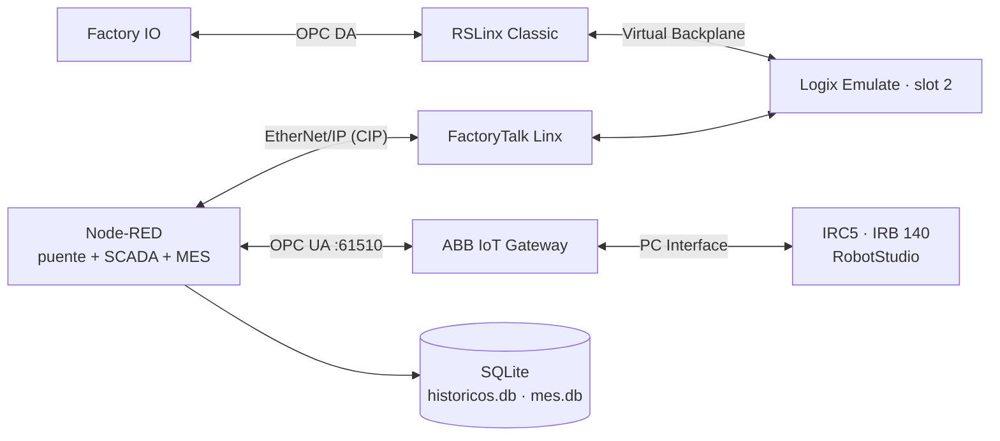

# Reto 2 SCADA: integración PLC Allen-Bradley y robot ABB

SCADA en Node-RED que supervisa y opera una celda Pick & Place simulada en Factory IO, controlada por un PLC Allen-Bradley (Studio 5000 Logix Emulate), y la coordina con un robot ABB IRB 140 (IRC5 virtual en RobotStudio) mediante un handshake de cuatro señales.

Juan Esteban Otavo García · SCADA y Controladores Industriales · Ingeniería Mecatrónica · Universidad Nacional de Colombia, sede Bogotá · 2026-II · Prof. Eduardo Barrera Gualdrón

Video de la demostración: _(enlace de YouTube)_

## Secuencia

Al contar 5 cajas, el PLC envía `ROBOT_START`. El robot recorre 2 trayectorias por ciclo, N ciclos (1 a 5, configurable desde el SCADA), y responde `ROBOT_DONE`. El PLC reinicia el conteo y la planta sigue con el siguiente lote.

| Señal | Quién la escribe | Función |
|---|---|---|
| `ROBOT_READY` | Robot → PLC | Robot disponible para una nueva orden |
| `ROBOT_START` | PLC → robot | Orden de iniciar; se sostiene hasta recibir DONE |
| `ROBOT_BUSY` | Robot → PLC | Robot ejecutando; bloquea órdenes nuevas y cambios de N |
| `ROBOT_DONE` | Robot → PLC | Fin de la rutina; el PLC baja START y pone el contador en 0 |

El robot no vuelve a READY hasta ver `ROBOT_START = 0`, así que una orden que se queda activa no repite la rutina.

## Arquitectura



No hay conexión directa entre el PLC y el robot: Node-RED copia las señales del handshake de un lado al otro. Factory IO y Node-RED llegan al mismo PLC por caminos distintos, y ningún tag lo escriben los dos; los comandos del SCADA usan tags propios.

## Contenido

```
plc/          Proyecto final de Studio 5000 (PickNPlace_Reto_2_SCADA_V3.ACD)
grafcet/      GRAFCET G0, G1 y G2 en nivel 1 y nivel 2 (SVG) y visor ver_grafcet.html
factory-io/   Escena de Factory IO con el driver OPC Client DA enlazado
robotstudio/  Estación de RobotStudio (Pack and Go) y módulo RAPID Reto2_Handshake.mod
node-red/     Flujos (flows.json) y paquetes de Node-RED (package.json)
```

### GRAFCET

- **G1 · Planta:** Pick & Place del Reto 1 más la etapa E10, donde la escena espera quieta mientras trabaja el robot.
- **G2 · Lote / robot:** R0 espera el lote, R1 activa START, R2 baja START y reinicia el contador.
- **G0 · Seguridad y modos:** STOP lleva la planta a E0; la emergencia la deja sin etapas, apaga las salidas y detiene el robot hasta el Reset.

### Flujos de Node-RED

| Pestaña | Función |
|---|---|
| 05 · Puente PLC ↔ robot | Lee el PLC por EtherNet/IP (58 tags, 250 ms) y el robot por OPC UA (12 variables cada 0,5 s). Copia el handshake en ambos sentidos, vigila la comunicación y el contador de vida `nVida`, y publica `plc` y `robot` en el contexto global |
| 06 · Dashboard | Pantalla ISA-101 en un `ui-template` (Dashboard 2.0). Comandos al PLC por pulsos de 1 s, 9 alarmas con reconocimiento, históricos en `historicos.db` y consulta por rango |
| 07 · MES | Capa de nivel 3 (extra): turnos, estados de la celda, OEE según ISO 22400 y KPIs de alarmas en `mes.db`. Solo lee; no escribe al PLC ni al robot |

### Alarmas

| Origen | Tag | Condición |
|---|---|---|
| PLC | `ALM_CAJA_NO_LLEGA` | Banda de entrada encendida sin caja en 20 s |
| PLC | `ALM_CAJA_PERDIDA` | Item detected cae más de 300 ms durante el traslado |
| PLC | `ALM_PINZA_VACIA` | El brazo bajó y no tomó ninguna caja |
| PLC | `ALM_ROBOT_NO_DISP` | Lote completo y robot sin READY en 10 s |
| PLC | `ALM_EMERGENCIA` | Parada de emergencia de la planta |
| Robot | `ROBOT_COM` | El IoT Gateway no responde |
| Robot | `ROBOT_TIEMPO` | BUSY más de 30 s × N ciclos |
| Robot | `ROBOT_DETENIDO` | `nVida` no avanza en 3 s (programa RAPID detenido) |
| Robot | `ROBOT_SIN_ARRANQUE` | START sin BUSY ni DONE durante más de 10 s |

Los presets de las alarmas del PLC se configuran desde el SCADA.

## Software usado

- Studio 5000 Logix Designer y Logix Emulate (controlador en el slot 2), RSLinx Classic y FactoryTalk Linx
- Factory IO con el driver OPC Client DA
- RobotStudio con RobotWare 6.16 (opciones 616-1 PC Interface y 1582-1 IoT Data Gateway) y ABB IoT Gateway 1.4
- Node-RED 5.0.9 con los paquetes de `node-red/package.json`

## Puesta en marcha

1. **PLC:** abrir `plc/PickNPlace_Reto_2_SCADA_V3.ACD`, descargarlo a Logix Emulate en el slot 2 y pasar a Run.
2. **Factory IO:** abrir la escena de `factory-io/`. Si se descarga de nuevo el programa al PLC, reconectar el driver OPC DA (Drivers › Disconnect/Connect).
3. **Robot:** abrir el Pack and Go de `robotstudio/` y ejecutar el módulo `Reto2_Handshake`. En IoT Gateway Config, crear el alias `robot` hacia el controlador. Después de cargar o cambiar el módulo RAPID, reiniciar el servidor del Gateway.
4. **Node-RED:**
   ```
   cd node-red
   npm install
   node-red -u .
   ```
   Arrancar Node-RED desde la carpeta `node-red`, porque las bases SQLite se crean ahí. En el nodo de configuración OPC UA hay que poner el usuario del Gateway y confiar el certificado de Node-RED en el Gateway (Client Certificates › Trust). Las credenciales no están en el repositorio.
5. **SCADA:** `http://127.0.0.1:1880/dashboard/reto2`

El alias del robot y el nombre del módulo RAPID son variables de entorno de la pestaña 05 (`ROBOT_ALIAS`, `RAPID_MOD`). Para el robot físico basta con crear el mismo alias en el Gateway apuntando al IRC5 real y cargar el mismo módulo.
